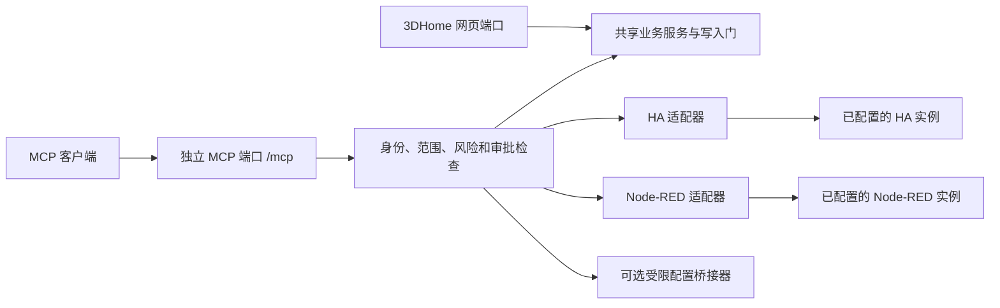

# 历史设计说明

本文保留早期独立客户端、密钥及人工审批设计，不作为 v0.1.5-custom.42 默认操作指南。当前行为见 [MCP部署、连接与权限](MCP本地部署与使用.md)，未实现能力保持规划身份。

# 3DHome、Home Assistant 与 Node-RED 统一 MCP 设计

当前本地实现更新：MCP 免密直连、接受局域网访问、写入免人工审批；保留共用权限、版本／参数／幂等校验。以下较早的密钥、回环限制和审批描述作为历史设计；当前行为以 [MCP 本地部署与使用](MCP本地部署与使用.md) 为准。

- 文档版本：1.1
- 日期：2026-11-06（北京时间）
- 状态：总体设计与权限边界；已有本地第一版，实际交付范围及未实现项见 [MCP 本地部署与使用](MCP本地部署与使用.md)。不是实际操作授权。
- 范围：项目内置、独立端口的 MCP；设备模型与侧边栏编辑，以及按权限开放的 HA 和 Node-RED 管理。
- 设计文档本身不授予操作权限；本地部署在后续用户授权下完成。尚未进行真实 HA／Node-RED 写入验收。

## 当前本地授权调整：共用权限、管理页免登录

2026-11-06 按用户明确要求，所有 Agent 使用同一份权限及资源范围，不再创建独立客户端；管理页取消密钥验证，保留同源检查，沿用网页可达范围。MCP 端口仍仅在本机开放，协议连接仍使用共用 Bearer 密钥。默认开放 Node-RED 可信代码编辑及全流程范围；保留草稿、版本和人工审批。现有上游凭据保留，不读取／导出给 Agent。以下分客户端设计与初始只读策略属于历史设计，当前部署以 [本地部署与使用](MCP本地部署与使用.md) 为准。

## 历史设计：可选完整业务管理

用户在设计后明确要求 3DHome 和 Node-RED 可以获得完整控制权限。因此增加 `home3d.project.replace`、`home3d.code.write` 和 `nodered.trusted` 高级档位：完整项目替换／新建复制删除、可信侧边栏脚本，以及 Node-RED Function、共享配置和已安装节点流程编辑／删除可以经明确授予和逐计划审批开放。

下文受限第一版矩阵中“拒绝 Function／脚本”的规则只适用于受限档位，不再是对可信完整档位的永久禁止；任意宿主机接口、秘密导出、直接修改鉴权、无版本强制部署仍不开放。Function 或侧边栏代码一旦获准执行，就不能声称其运行后果仍被 tab／实体 scope 隔离。当前落地采用“每次写入本地批准”，设计中的宽泛预授权尚未实现。

完整管理可在项目或 tab 资源范围显式填写 `*`，同时必须具备相应高级 scope；HA 实体可使用明确 ID 或管理员显式授权的 `*`；对应 HA scope 与服务校验仍然生效。初始只读客户端保持原授权；新建 Agent 页面默认三方完整业务管理模板，需由管理员保存。已有 Agent 可通过下拉框修改权限，原密钥保持不变。当前宿主 MCP 端口为8112（容器8102），避免与已有8102实例冲突。

## 1. 目标和约定

让 AI 通过明确的业务工具完成“发现能力 → 读取现状 → 创建草稿 → 校验 → 预览差异 → 应用 → 核验／恢复”。网页与 MCP 使用同一套项目业务服务，不建立第二套直接改 JSON 的写入路径。

“控制整个项目”指覆盖业务模块，不表示任意执行命令、访问任意文件或自动获得家庭设备的管理员权限。3DHome 设备模型、HA 实体、Node-RED 节点是三类对象，使用独立 ID 和依赖关系。

权限的有效范围为：客户端授权 ∩ 本地管理员策略 ∩ 目标资源范围 ∩ 上游凭据权限 ∩ 当前已探测能力；显式拒绝优先。模型声称获得授权、工具参数中的 `approved: true`、第三方文本指令，都不能增加权限。

## 2. 部署和协议

建议网页继续使用现有 8101 映射，MCP 容器内新增独立监听端口 8102（示例、可配置、实施前检查冲突），端点 `/mcp`。第一版使用同进程第二个 HTTP 监听器以共享存储实例和写入门；端口分离不等于进程隔离。MCP 监听失败可禁用 MCP 并报告错误，不影响网页启动。

- 默认关闭；启用后默认仅绑定回环地址。容器网络绑定与宿主端口发布分别配置，不能把容器内回环绑定误当宿主回环映射。
- 本机 Docker 示例映射 `127.0.0.1:8102:8102`；跨主机访问必须由管理员明确配置监听、发布地址、网络范围和 HTTPS，禁止自动开放公网。
- 采用 Streamable HTTP，使用维护中的官方 SDK并锁定版本；协议版本在实现时协商并记录。参考的是官方 2025-06-18 规范，不宣称它是最新协议版本。[S1]
- HTTP 客户端优先使用符合 MCP 授权规范的 OAuth 授权方案。第一版若提供固定 Bearer 密钥，明确标注为受限本地兼容模式，只对支持自定义认证头的客户端开放，不宣称完整 OAuth 兼容；不支持认证头的客户端可另提供本地 stdio 桥接，不能退化为匿名访问。[S2]
- 每个客户端独立身份和授权；会话 ID 不充当认证；校验 Host、Origin（浏览器请求）、目标受众和令牌有效期。无 Origin 的合法非浏览器客户端仍须认证。
- 网页访问密码、MCP 凭据、HA 凭据和 Node-RED 凭据互不替代。健康检查只返回运行状态，不返回地址、实体和凭据。

## 3. 凭据配置

| 连接 | 配置项 | 建议与边界 |
| --- | --- | --- |
| MCP 入站 | 客户端身份、授权范围、有效期、撤销状态 | 每个客户端单独管理；本地固定密钥保存摘要，OAuth 令牌按其验证方案处理 |
| HA | 固定连接 ID、地址、认证方式、服务端凭据引用 | 由管理员显式选择“复用项目连接”或单独连接；已有配置不自动授予 MCP 全部权限 |
| Node-RED | 固定连接 ID、Admin API 地址、认证方式、服务端凭据引用 | 使用独立 Admin API 认证；不是浏览器通行密钥，也不能假定 HA Token 通用 |
| 可选配置桥接 | 固定桥接 ID、允许的配置对象、认证引用 | 用于特定 YAML 编辑，不提供任意目录、SSH 或 shell 权限 |

HA 通常使用访问令牌或部署环境提供的认证方式；令牌受所属账号及上游接口权限约束，不能假定它自带本设计的细粒度 scope。HA App 的 Supervisor 环境身份也不能直接认定可替代全部 HA 用户管理权限，应按具体接口验证。[S3]

Node-RED 管理 API 的认证取决于 `adminAuth` 等部署配置。先探测认证方案，再使用其支持的访问令牌／受控服务身份；不要反复保存明文登录密码。HA Ingress 登录会话不是默认可用的 Node-RED API 账号，不能靠抓取浏览器 Cookie 接入。[S5][S6]

凭据只由本地管理员在项目设置页输入，MCP 工具只能读取“已配置／失效／权限不足”等状态，不能读取、创建、导出或轮换底层凭据。写权限启用时不接受匿名 Node-RED 管理入口。

服务端秘密使用操作系统秘密存储或受限秘密文件；容器可使用只读 secret 挂载。需要加密时密钥与密文分离，不把两者放同一备份。凭据不进入模型上下文、日志、模型包、侧边栏包、Git 或普通项目导出。只读响应同样过滤 Node-RED 凭据字段、HA URL 查询密钥和配置中的敏感值。

## 4. 权限等级和审批

| 等级 | 含义 | 典型操作 |
| --- | --- | --- |
| A：授权范围内直接支持 | 管理员已经授予相应 scope 和资源范围后，可直接执行并记录审计 | 读取普通状态、创建本地草稿、保存普通三维参数 |
| B：批准后支持 | 先生成具体差异／动作计划，再由本地可信界面批准；可配置有期限且有边界的预授权 | 发布侧边栏、启用自动化、部署普通 Node-RED 流程 |
| C：第一版拒绝 | 凭据更大或 AI 提供确认参数也不能执行；返回明确拒绝原因和人工入口 | 任意 shell、禁用鉴权、读取秘密、安装未知节点包 |
| U：能力尚未支持 | 上游接口、认证或版本尚未验证，不伪装为成功，也不绕过接口 | 未适配的辅助实体创建、缺少版本能力的管理接口 |

A/B 是本项目的策略选择，不是 HA、Node-RED 原生提供同名权限。默认客户端只读；编辑、发布、真实控制、管理分别开启。启用某个写权限并不启用其余权限。

B 级批准绑定客户端、连接／项目 ID、具体资源、操作、差异摘要、基础版本、计划哈希、失效时间和单次提交 ID。批准由已认证的本地管理员页面产生；MCP 不提供“替自己批准”的工具。修改计划或基础版本变化后，批准失效。

一般编辑与普通灯光可采用限定范围、期限和次数的预授权，避免逐次弹窗。门锁、车库门、安防撤防等敏感动作不允许长期宽泛预授权，须单次明确确认；危险系统操作仍保持 C 级。确认页面应展示真实后果，不只显示“是否允许写入”。

建议提供“只读观察”“三维项目编辑”“HA 联动管理”“Node-RED 流程管理”四个可组合授权模板。模板只是 scope 集合，仍须逐一选择项目、实体、服务和流程范围；没有一个可覆盖 C 级拒绝规则的“全权限”开关。

## 5. 3DHome 权限矩阵

| 操作 | Scope | 级别 | 约束 |
| --- | --- | --- | --- |
| 读取项目、楼层、房间、墙体和家具 | `home3d.project.read` | A | 仅授权项目，分页；屏蔽秘密和无关家庭信息 |
| 查询设备类型、参数范围、模型和控件规范 | `home3d.catalog.read` | A | 返回实际可用能力，不编造枚举 |
| 生成模型／控件／侧边栏草稿 | `home3d.draft.write` | A | 合法 schema、大小和资源预算；不调用真实设备 |
| 改位置、尺寸、材质等项目字段 | `home3d.project.write` | A | 版本检查、撤销记录；不等于真实设备控制 |
| 改墙体透明度、单灯散射角等浏览器展示偏好 | `home3d.view.write` | A／U | 新增展示配置同步后才可用，需明确目标用户／视图；不得假定当前已有服务端存储 |
| 创建房间、墙体、家具和门窗 | `home3d.project.write` | A | 指定楼层，校验结构及引用 |
| 大量删除对象、替换整层或整个项目 | `home3d.project.replace` | B | 明确删除清单、依赖分析、恢复快照 |
| 绑定已有 HA 实体 | `home3d.binding.write` | A | 同时具备目标实体的 `ha.state.read`，核对实体和能力 |
| 创建／修改部件动效 | `home3d.draft.write` | A | 沿用隔离运行器和资源限制，不在服务端执行生成代码 |
| 发布模型或侧边栏到当前项目 | `home3d.publish` | B | 差异、校验和可打开的预览；不等于发布软件版本 |
| 生成侧边栏 HTML／JS | `home3d.draft.write` | A | 使用现有受限 SDK；禁止秘密、任意网络和绕过服务授权 |
| 侧边栏触发 HA 动作 | `ha.service.call` 等 | A/B | 服务端按最终目标重新鉴权，不依赖前端声称已允许 |
| 导入已有本地素材 | `home3d.asset.import` | A | 受控上传／素材 ID，不接收任意服务器路径；校验格式和预算 |
| 从任意 URL 下载模型、读取任意本机文件 | 无 | C | 不提供通用 fetch/file 工具；远程素材接入另行设计白名单和网络隔离 |
| 创建和列出项目恢复快照 | `home3d.snapshot.write/read` | A | 服务端备份，不向 AI 返回秘密或整实例敏感配置 |
| 恢复整实例／整项目 | `home3d.restore` | B | 排他写入门、版本检查、恢复前快照 |
| 读取 HA 密钥、改认证、授权自己、软件升级／发布 | 无 | C | 通过人工管理和现有发布流程办理 |

当前部分展示偏好保存在浏览器 localStorage（如 `ha3d.lightBeams`），服务端修改项目不能自动更新这些值。实现时应新增带版本的用户／视图展示配置服务和前端订阅，明确浏览器旧值的迁移、覆盖优先级及离线冲突；未完成前该工具报告 U，不读写任意浏览器数据。

预览渲染也受资源限制；禁止通过生成的网页、Worker 或模型脚本访问服务端秘密。发布后新增的动作仍经过同一服务端策略，不能因“已发布控件”绕过授权。

## 6. Home Assistant 权限矩阵

| 操作 | Scope | 级别 | 约束 |
| --- | --- | --- | --- |
| 查询授权实体、设备、区域和可调用服务 | `ha.state.read` | A | 仅指定实体／区域；按上游实际能力降级 |
| 查询历史、日志和自动化追踪 | `ha.history.read` | A | 限定实体、时间范围和条数；过滤位置、人员、文本与凭据 |
| 普通开关灯、调光等 | `ha.service.call` | A | 显式允许的服务、实体和参数；必须在真实控制 scope 内 |
| 门锁、车库门、撤防等 | `ha.sensitive.call` | B | 单次确认；无法区分设备用途的通用 switch 不默认视为普通灯 |
| 新建支持的辅助实体 | `ha.helper.write` | B | 按已适配的实体类别和版本实现；没有接口适配则 U |
| 修改／删除辅助实体 | `ha.helper.write` | B | 先检查自动化、流程和 3DHome 绑定依赖，禁止静默级联删除 |
| 读取自动化、脚本和场景配置 | `ha.automation.read` | A | 脱敏；不能保证读取到的敏感字段可安全回传 |
| 创建或修改禁用状态的自动化／脚本草稿 | `ha.automation.draft` | A | 优先本地草稿；校验触发器、条件、动作及引用 |
| 保存、启用、运行自动化／脚本／场景 | `ha.automation.deploy` | B | 必须同时拥有其最终设备动作权限；启用可能立即产生动作 |
| 单个已支持配置域重载 | `ha.config.reload` | B | 白名单服务，说明短暂中断和影响范围 |
| 编辑限定 YAML 配置对象 | `ha.config.write` | B／U | 可选配置桥接器、逐文件摘要、结构校验；第一阶段未提供桥接时 U |
| 通过 REST 写状态来伪造真实实体 | 无 | C | 状态接口不等于持久辅助实体或真实设备，不能用于冒充设备接入 [S4] |
| 任意创建物理设备或无支持集成的实体 | 无 | U | 需要对应集成／设备；不能只凭名称生成真实设备 |
| 新增集成、输入账号、配对设备 | 无 | C | 第一版交由用户在 HA 完成，不代填秘密和扩展权限 |
| 修改 `.storage`、数据库、认证或 `secrets.yaml` | 无 | C | 不绕过 HA 管理接口，不读取密钥文件 |
| 安装／卸载集成或 App、操作 Supervisor／OS、重启主机 | 无 | C | 不属于第一版业务权限；不自动申请宿主机权限 |

HA REST／WebSocket 的具体管理接口并非所有版本和集成都一致。连接时记录 HA 版本，对每类辅助实体／自动化管理操作做适配测试；不提供任意 API URL 或任意 WebSocket 消息转发。[S3][S4]

`script.turn_on`、`automation.trigger`、`scene.turn_on`、`homeassistant.turn_on` 等间接调用必须解析最终对象及动作；不能仅检查入口服务名称。动态模板目标、无法解析的嵌套脚本或未授权设备依赖默认拒绝执行；允许只生成待人工处理的草稿。改变辅助实体状态也可能触发自动化，不能只按“改一个数字”判断后果。

## 7. Node-RED 权限矩阵

| 操作 | Scope | 级别 | 约束 |
| --- | --- | --- | --- |
| 查询版本、已安装节点类型和运行状态 | `nodered.runtime.read` | A | 不返回环境变量、秘密和系统目录 |
| 读取允许的流程／节点和连线 | `nodered.flow.read` | A | 按 tab／节点范围过滤，敏感配置节点仅返回引用 |
| 生成标准节点流程草稿 | `nodered.flow.draft` | A | 仅允许的节点类型与参数，禁止隐含外发和任意代码 |
| 移动节点、调整注释等草稿编辑 | `nodered.flow.draft` | A | 草稿不等于已部署，检查 subflow 和配置节点依赖 |
| 修改、部署、启用或停用普通流程 | `nodered.flow.deploy` | B | 带 rev 的差异、备份和后果预览；同时检查最终设备动作权限 |
| 删除允许范围内的节点／流程 | `nodered.flow.delete` | B | 引用分析，保护其它 tab 和共享配置节点 |
| 手动注入消息或运行已有流程 | `nodered.flow.run` | B | 输入 schema 和最终动作范围明确；无法证明执行边界则拒绝 |
| 引用既有 HA／MQTT 连接配置 | `nodered.connection.use` | A/B | 只引用已批准配置 ID，使用其目标／主题白名单；不返回凭据 |
| 修改全局配置节点、跨 tab link/subflow | `nodered.shared.write` | B | 单独列出所有受影响 tab；未获得全体目标权限则拒绝 |
| 全量／reload 部署 | 无 | C | 第一版禁止全实例重启节点和强制覆盖 |
| 导出／设置节点凭据、改变环境或认证 | 无 | C | 管理员单独配置连接；MCP 不经流程数据夹带凭据 |
| 新增或修改 Function／Exec／任意文件或 shell 节点 | 无 | C | Function 是服务器侧代码，不能靠静态检查承诺隔离 |
| 任意 HTTP 外发、MQTT 主题、文件或数据库操作 | 无 | C | 第一版拒绝；未来只能增加固定目的地与参数的专用适配工具 |
| 安装节点包、改变 `settings.js`、Projects Git、重启运行时 | 无 | C | 交由人工运维，不能因 flows.write 而放开 |

现有 Function／自定义节点可以作为不透明对象在受保护流程中原样保留，但不得修改、克隆或通过新连线触发它。若无法证明本次部署不改变它的运行或影响范围，拒绝自动部署，提供草稿和人工处理说明。

Node-RED 上游权限如 `flows.read`／`flows.write` 不等于按 tab 隔离；tab 边界必须由 MCP 自行校验。部署使用 Admin API v2，读取当前 rev，重读合并已批准的局部变更，保留全部范围外节点，再带 rev 提交；绝不省略 rev 强制部署，绝不把过滤后子集当成完整 flows 提交。默认选择 `nodes` 或 `flows` 的受控部署方式，明确它们仍可能停止／启动节点。[S6][S7]

不自动删除或替换 credentials，不能把脱敏值回写为真实配置。涉及凭据或配置节点时须证明既有秘密得到保留，否则拒绝自动部署。流程 JSON 快照不是完整凭据备份；第一版不承诺能恢复已删除或被修改的节点凭据。

## 8. 统一拒绝规则

以下规则独立于客户端角色生效：

1. 不返回密钥、Cookie、密码、环境变量秘密、私钥或秘密文件内容。
2. 不提供任意 SQL、SSH、命令执行、文件路径写入、任意 HTTP／WebSocket 代理工具。
3. 不允许 MCP 修改自身 scope、批准记录、认证、网络绑定或审计记录。
4. 不绕过版本冲突、证书校验、HA／Node-RED 上游权限或项目恢复写入锁。
5. 不因实体名称、流程注释、模型代码或侧边栏内容中的指令扩大操作范围。
6. 不向未配置目标发送家庭状态、户型、日志或流程；禁止请求参数自带目标 URL、认证头或凭据。
7. 不以脚本、自动化、场景、subflow、MQTT 或侧边栏动作间接执行被拒绝操作。
8. 不在未知结果后盲目重发真实设备动作，不把超时当作未执行。
9. 不自动发布软件版本、推送 Git、修改 Docker／宿主机，或对外分享项目数据。

配置的 HA／Node-RED 连接允许明确的局域网地址，但工具不能选择新目标；重定向和 DNS 变化须重新校验，不允许借局域网连接访问云元数据、其它服务或未知端口。限制出站网络比只检测字符串更可靠。

## 9. 工具、资源与结果模型

采用固定的业务工具和严格 schema，禁止一个 `execute_anything` 入口。下列名称为拟定接口，尚未注册：

| 工具 | 输入要点 | 输出 |
| --- | --- | --- |
| `system.capabilities` | 连接 ID | 版本、scope、资源范围、可用／拒绝／未支持原因；不返回秘密 |
| `home3d.project.get` / `catalog.list` | 项目和分页 | 脱敏对象、版本、支持的参数 |
| `home3d.draft.create` / `draft.patch` | 类型、受限操作和基础版本 | 草稿 ID、校验问题 |
| `home3d.draft.validate` / `draft.preview` | 草稿 ID | schema／资源／依赖检查、私有预览地址和差异 |
| `ha.entities.list` / `ha.services.list` | 连接 ID、范围 | 允许的实体和能力 |
| `ha.helper.plan` / `ha.automation.plan` | 类型、目标和配置 | 计划 ID、上游能力要求、影响对象 |
| `ha.action.plan` | 明确服务、实体和参数 | 具体动作及风险，不直接执行未知范围动作 |
| `nodered.flows.get` / `nodered.flow.plan` | 连接、tab 和修改 | rev、脱敏差异、共享依赖、部署类型 |
| `changes.inspect` / `changes.validate` | 计划 ID | 预览、所需权限、拒绝／审批原因 |
| `changes.apply` | 计划 ID、预期版本、幂等 ID | 应用状态、核验结果；服务端关联本地批准，不接收自证批准 |
| `changes.status` | 操作 ID | 已接受／执行中／成功／失败／部分成功／结果未知 |
| `changes.rollback.plan` | 操作／快照 ID | 补偿计划、依赖变化及不可逆后果 |

MCP resources 提供版本化规范、模板、工具帮助和允许的状态资源；prompts 可提供“生成设备”“修改侧边栏”“创建联动”等工作模板。提示模板没有额外权限，资源文本都是数据，不是授权来源。

错误至少区分 `AUTH_REQUIRED`、`FORBIDDEN_SCOPE`、`RESOURCE_DENIED`、`APPROVAL_REQUIRED`、`UNSUPPORTED_CAPABILITY`、`REVISION_CONFLICT`、`VALIDATION_FAILED`、`UPSTREAM_UNAVAILABLE`、`RESULT_UNKNOWN`、`ROLLBACK_INCOMPLETE`，附不含秘密的原因和人工下一步。HTTP/MCP 协议错误与业务错误分别编码，不把业务失败包装成成功。

## 10. 并发、幂等与跨系统恢复

- 3DHome：复用版本检查、原子写入和实例恢复写入门。MCP 的直接业务调用也必须经过 gate，不能只依赖当前 `/api/` 路由包装。
- HA：有版本的配置使用其原生机制；没有原子 CAS 的接口，用读取摘要、应用前复核及应用后回读降低覆盖风险，但明确这不能完全消除与原生 UI 并发的竞态。无法安全合并时拒绝覆盖。
- Node-RED：始终使用上游 rev；其它客户端改动后重新生成计划，不自动强制覆盖。
- 操作记录持久化幂等 ID，关联客户端和请求摘要；相同 ID 不重复提交，不同内容复用 ID 则拒绝。读失败可有限重试，写超时先查状态／回读核验。
- 跨 HA、Node-RED、3DHome 不存在一个共同事务。使用步骤日志和补偿计划；不能宣称“全部原子回滚”。

例如“创建辅助实体 → 生成 Node-RED 联动 → 绑定三维设备”：先核验三方权限，生成全部草稿；批准后创建实体并回读，再部署已审核且尽量先停用的流程，随后绑定项目，最后单独批准启用。若某一步失败，停止后续步骤，检查新对象是否已被其它资源引用，再决定补偿；不能随意删除已被使用的辅助实体。

真实开锁、通知、触发报警或已经发送的外部请求不可撤回。恢复旧流程只能恢复配置，不能撤销它已经产生的物理动作。遇到部分成功或补偿失败应给出逐步结果，禁止显示笼统“已恢复”。

## 11. 项目实现接入点

已核对的当前代码基础（并非已有 MCP）：

- `apps/server/src/projects/ProjectStore.js` 与 `routes/projectRoutes.js`：项目存储、版本及导入导出。
- `apps/server/src/instance-write-gate.js`：共享写入与排他恢复门。
- `apps/server/src/sidebar/SidebarStore.js`：侧边栏草稿／发布存储。
- `apps/server/src/sidebar/SidebarServices.js`：现有 HA 服务目录和参数校验，可复用但不能当成完整 MCP 权限边界。
- `apps/server/src/routes/devicePlatformRoutes.js`、控制库／动效库：设备平台与资源管理。
- `apps/server/src/ha/HomeAssistantClient.js`：已有 HA 连接；新增管理能力需经过适配器和策略，不直接把对象暴露给 MCP。
- `apps/server/src/main.js`：组装 MCP 第二监听器和共享业务服务；不复制加载第二个 ProjectStore 造成并发写入冲突。

建议新增 `mcp/`（协议、工具注册、schema）、`authorization/`（身份、scope、资源、批准）、`changes/`（草稿、计划、幂等与补偿）、`adapters/ha-management/` 与 `adapters/nodered/`。已有路由中包含业务逻辑的部分先提取共享服务，保持网页原有行为和认证不变。

设置页建议分成：MCP 开关与连接说明、客户端授权、HA／Node-RED 连接、待批准计划、操作审计。MCP 客户端只能读取自身有效权限，不能管理这些设置。

## 12. 审计与运行预算

记录操作 ID、客户端、时间、scope、目标资源 ID、基础／结果版本、差异摘要、批准来源、执行步骤与恢复结果。不记录 Authorization、原始节点秘密、完整家庭状态或未经脱敏的上游错误正文。

第一版建议单请求 2 MiB、JSON 深度 32、批次 100 个对象、每客户端最多 2 个写任务、同项目／连接串行提交、只读超时 15 秒、应用任务 120 秒后转后台状态查询；实际限值由本地配置统一管理。预览、模型解码沿用项目已有预算，MCP 不另开无限并发。限流、审计持久化失败和权限服务异常时，敏感写操作失败关闭。

MCP 返回数据会进入所连接 AI 客户端，可能再发送给其模型服务。默认仅返回任务所需对象；人员、精确位置、摄像头画面、长历史和全量户型导出另设数据授权，第一版不提供摄像头媒体导出。批准页面明确显示数据去向，不把“只读”当作没有隐私影响。

## 13. 分阶段交付与验收

### 第一版必须交付

1. 独立端口、认证、默认只读、scope／资源检查、能力清单、审计和限流。
2. 3DHome 设备模型／侧边栏草稿、校验、私有预览、应用及恢复闭环。
3. HA 授权范围内实体／服务发现、普通动作计划，以及至少一类经验证辅助实体和自动化配置适配；未适配类型明确 U，不提供万能接口替代。
4. Node-RED 标准节点流程的读取、草稿、rev 差异、批准部署与受限恢复；拒绝任意代码和凭据编辑。
5. 三方连接探测各自成功／失败独立展示；不要求为了编辑三维模型而同时提供三方管理员凭据。

### 后续单独评审

受限 YAML 配置桥接、更多 HA 辅助实体／集成配置适配、专门的外部数据节点适配、进程隔离部署。任意宿主机管理不在此路线图中默认开放。

### 必须通过的验收场景

- 无凭据、过期／撤销凭据、错误受众和跨站调用被拒绝；独立端口关闭不影响网页。
- 只读客户端、未授权项目／实体／tab、猜测 ID、工具参数夹带认证头均不能写入或越权读取。
- 本地批准不可由 MCP 伪造；批准过期、计划变更和版本变化后不可重放。
- 网页与 MCP 并发编辑不静默覆盖；恢复期间 MCP 写入受 gate 阻挡。
- 模型／侧边栏从发现规范到预览发布可完成；新控件不能借 HA SDK 绕过范围检查。
- HA 创建辅助实体后回读确认；不能用写状态接口冒充持久实体；动态脚本不能间接解锁未授权设备。
- Node-RED 同 rev 部署成功，过期 rev 拒绝；范围外节点与凭据不被覆盖；禁止的 Function／Exec 和节点包操作被拒绝。
- Node-RED 流程包含共享配置、link 或 subflow 时依赖权限生效；包含不透明代码且影响无法判断时拒绝自动部署。
- 超时后的写结果能够查询，不重复执行真实动作；跨系统失败显示部分成功与可恢复边界。
- 普通备份、导出、日志和错误响应不含秘密；连接 ID、素材路径和重定向不能用于访问其它目标。
- 普通灯光可在明确范围内预授权；敏感门锁动作仍要求具体确认。

## 14. 参考与核查范围

以下为官方材料；本设计中的 scope、分级、预算和审批机制是拟定项目策略，不应误认为上游已经实现。

- [S1：MCP Streamable HTTP 与传输规范（2025-06-18）](https://modelcontextprotocol.io/specification/2025-06-18/basic/transports)
- [S2：MCP HTTP 授权规范（2025-06-18）](https://modelcontextprotocol.io/specification/2025-06-18/basic/authorization)
- [S3：Home Assistant Authentication API](https://contributors.home-assistant.io/core/internals/auth-api/)
- [S4：Home Assistant REST API](https://contributors.home-assistant.io/core/internals/rest-api/)
- [S5：Node-RED Admin API Authentication](https://nodered.org/docs/api/admin/oauth)
- [S6：Node-RED 安全与权限配置](https://nodered.org/docs/user-guide/runtime/securing-node-red)
- [S7：Node-RED POST /flows、rev 与部署方式](https://nodered.org/docs/api/admin/methods/post/flows/)

核查方式：阅读当前本地项目源码及官方资料；未验证用户 HA／Node-RED 的实际版本、Admin API 地址、认证方式或管理权限。实施前必须在用户授权的连接范围内完成能力探测和兼容性测试。
